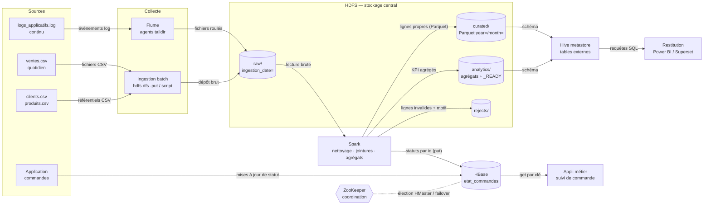

# TP 6 — Concevoir un pipeline avec l'écosystème Hadoop

## Mission A — Cartographie

| Composant | Catégorie | Rôle et type de données | Dans notre contexte |
|---|---|---|---|
| **Hive** | Requêtage SQL | Expose des fichiers HDFS (CSV, Parquet, ORC) comme des tables. Les requêtes HiveQL sont compilées en jobs Tez ou Spark. Le *metastore* garde les schémas | Les analystes calculent le CA par pays ou par mois en SQL sur `ventes`, sans écrire de code distribué |
| **HBase** | NoSQL orienté colonnes | Base clé-valeur sur HDFS : lecture et écriture **aléatoires à faible latence** par clé de ligne, et versions des cellules | `etat_commandes` : lire ou mettre à jour le statut d'une commande à partir de son identifiant, en quelques millisecondes |
| **Pig** | Flux de transformation (historique) | Scripts Pig Latin (LOAD, FILTER, JOIN, GROUP) compilés en MapReduce | Ancien flux de préparation : charger les ventes, filtrer les quantités ≤ 0, joindre les produits, grouper par pays |
| **Flume** | Collecte de logs | Agents *source → channel → sink* qui transportent des événements en continu de façon fiable | Collecter `logs_applicatifs.log` sur chaque serveur (source *taildir*) vers HDFS (sink `hdfs`, fichiers roulés par taille ou par heure) |
| **ZooKeeper** | Coordination distribuée | Petit magasin de configuration hautement disponible : élection de leader, verrous, détection de pannes. Il **ne stocke pas de données métier** | Coordonne HBase (HMaster actif, RegionServers), la haute disponibilité du NameNode (*failover controller*) et Kafka dans les anciennes versions |
| **Spark** | Traitement distribué | Moteur de calcul en mémoire : batch, SQL, streaming, ML, sur des DataFrames | Nettoyer, dédoublonner, joindre clients et produits, agréger les ventes, écrire en Parquet dans `curated` et `analytics` |

## Mission B — Le bon outil

1. **CA mensuel par pays en syntaxe SQL** : **Hive**, ou Spark SQL avec le metastore Hive. La table
   externe est posée sur HDFS, partitionnée par date. L'analyste écrit du SQL standard.
2. **État d'une commande par identifiant, immédiatement** : **HBase**. L'accès par clé de ligne se
   fait en quelques millisecondes et supporte les mises à jour fréquentes. Hive scannerait des
   fichiers entiers pour une seule ligne.
3. **Logs continus de plusieurs serveurs vers HDFS** : **Flume**. Des agents sur chaque serveur
   transmettent avec un canal tampon (fichier) et écrivent dans HDFS par lots roulés. Aujourd'hui,
   on utiliserait souvent Kafka avec un connecteur HDFS ou du Spark Streaming.
4. **Nettoyer, joindre et agréger des millions de lignes** : **Spark**. Il travaille en mémoire,
   optimise avec Catalyst, fait des jointures broadcast, et s'exécute 10 à 100 fois plus vite que
   MapReduce sur ces traitements en plusieurs étapes.
5. **État de coordination partagé et basculement** : **ZooKeeper**. Il fournit l'élection de leader,
   les nœuds éphémères pour détecter une panne et un consensus (ZAB) fiable.
6. **Moderniser un flux Pig** : réécrire en **Spark** (DataFrame ou SQL). Les mêmes opérations
   (LOAD, FILTER, JOIN, GROUP) existent en DataFrame. On gagne l'exécution en mémoire et un
   optimiseur. On gagne aussi des tests unitaires en Python et un langage maintenu, car Pig n'évolue plus.

## Mission C — Architecture



Les contraintes de l'énoncé sont respectées :

- HDFS reste la zone centrale ;
- les logs passent par Flume avant d'être stockés ;
- les tables d'analyse sont interrogeables en SQL via Hive ;
- les statuts sont dans HBase, séparés des fichiers analytiques ;
- Spark nettoie et agrège ;
- ZooKeeper n'est relié qu'en **coordination**, en pointillés : ce n'est ni un moteur de stockage ni un moteur de calcul.

## Mission D — Déroulement du pipeline

Chaque étape indique son entrée, le composant utilisé, l'action et la sortie produite.

1. **Collecte des logs.** Les logs applicatifs de chaque serveur sont lus par un agent **Flume**
   (source taildir, canal fichier). Ils sont écrits dans `/data/raw/logs/ingestion_date=J/`, en
   fichiers roulés toutes les heures ou tous les 128 Mo.
2. **Ingestion des ventes.** Le fichier `ventes.csv` du jour est déposé par un **script d'ingestion**
   (`hdfs dfs -put`) dans `/data/raw/sales/ingestion_date=J/`.
3. **Ingestion des référentiels.** Les fichiers clients et produits sont déposés de la même façon
   dans `raw/customers/` et `raw/products/`. On garde une version par jour de réception.
4. **Contrôle d'arrivée.** Un script vérifie la présence et la taille des fichiers (`hdfs dfs -test`,
   `-du`). Si tout est en ordre, il écrit `_INGESTED`, sinon il lève une alerte.
5. **Nettoyage.** **Spark** lit `raw/sales` avec un schéma explicite et en mode PERMISSIVE. Il
   supprime les doublons et écarte les quantités ≤ 0 et les pays absents. Les lignes propres
   partent dans `curated/sales/year=/month=` (Parquet), et les lignes invalides avec leur motif
   dans `rejects/sales/`.
6. **Enrichissement.** **Spark** joint les ventes propres avec les produits (broadcast) et les
   clients. Le résultat est la table `curated/ventes_enrichies` en Parquet, partitionnée par mois.
7. **Agrégation.** **Spark** calcule le CA par pays, par mois et par famille à partir de
   `curated/ventes_enrichies`. Il écrit `analytics/ca_pays_mois/` puis le marqueur `_READY`.
8. **Exposition SQL.** Les dossiers `curated` et `analytics` sont déclarés comme tables externes
   dans le **metastore Hive** (`MSCK REPAIR` pour les nouvelles partitions). Les analystes et la BI
   les interrogent en HiveQL ou Spark SQL.
9. **Statuts temps réel.** Les mises à jour de statut des commandes sont écrites dans **HBase**
   (clé de ligne `id_commande`) par l'application, ou par un job Spark pour l'historique.
   L'application lit le statut par `get`.
10. **Coordination.** **ZooKeeper** assure l'élection du HMaster HBase et le basculement du
    NameNode en haute disponibilité. Il ne voit passer aucune donnée métier.
11. **Restitution.** L'outil de BI lit les tables `analytics` via Hive ou Spark SQL. Il ne
    rafraîchit ses données qu'après l'apparition de `_READY`.
12. **Cycle de vie.** Un job planifié archive `raw/` au-delà de 90 jours et contrôle le nombre et la
    taille des fichiers par partition, pour éviter les petits fichiers (TP 4).

## Mission E — Hive et Spark

- HiveQL (table externe et CA par pays) : [`hive_ventes.sql`](hive_ventes.sql)
- Spark, sous forme de code réel et non de pseudo-code : [`spark_ca_par_pays.py`](spark_ca_par_pays.py).
  Résultat d'exécution : [`resultat_spark.md`](resultat_spark.md), CA total de **12 982,80 €**,
  recoupé à l'identique avec pandas.

```python
ventes = spark.read.schema(SCHEMA).option("header", True).csv("hdfs:///data/raw/sales")
ca = (ventes.dropDuplicates()
            .filter((F.col("quantite") > 0) & F.col("pays").isNotNull())
            .groupBy("pays")
            .agg(F.round(F.sum(F.col("quantite") * F.col("prix")), 2).alias("ca")))
ca.write.mode("overwrite").parquet("hdfs:///data/analytics/ca_pays")
```

| | Hive | Spark |
|---|---|---|
| Objectif | Rendre les fichiers HDFS interrogeables en SQL (entrepôt) | Moteur de calcul distribué généraliste |
| Type de traitement | Requêtes SQL batch, déclaratives | Batch, SQL, streaming, ML ; transformations en plusieurs étapes |
| Utilisateur cible | Analyste, BI, profil SQL | Data engineer ou data scientist (Python, Scala, SQL) |
| Point fort | Metastore (schémas partagés), SQL standard | Vitesse en mémoire, Catalyst, API riche, tests unitaires |

Les deux se complètent : Spark lit et écrit les tables du **metastore Hive**.

## Mission F — Recommandation (15 lignes)

1. **Indispensables** : HDFS (stockage central et répliqué), Spark (nettoyage, jointures,
   agrégats) et une couche SQL (metastore Hive avec Hive ou Spark SQL) pour les analystes.
2. HBase et ZooKeeper ne sont justifiés que par le besoin d'accès par identifiant
   (`etat_commandes`). ZooKeeper vient avec HBase et la haute disponibilité.
3. **Historiques ou à éviter dans un nouveau projet** :
   - Pig, remplacé par Spark ;
   - MapReduce écrit à la main ;
   - Sqoop, retiré en 2021 (remplacé par Spark JDBC) ;
   - Oozie, retiré (remplacé par Airflow) ;
   - Flume peut être remplacé par Kafka pour les flux.
4. **HBase apporte ce que Hive n'a pas** : la lecture et l'écriture aléatoires d'**une ligne par
   clé** en quelques millisecondes, les mises à jour fréquentes et les versions de cellules. Hive
   scanne des fichiers et sert à l'analyse de masse.
5. **Spark ne remplace pas HDFS** : c'est un moteur de **calcul** sans stockage durable. Il lit et
   écrit sur un système de fichiers (HDFS, S3). Son cache est volatil, et la tolérance aux pannes
   des données vient de la réplication de HDFS.
6. **Risques d'empiler les outils sans besoin** :
   - chaque composant ajoute de l'exploitation (versions, sécurité, supervision, montées de version) ;
   - il faut des compétences rares ;
   - les données se dupliquent entre systèmes ;
   - les incohérences se multiplient ;
   - les pannes se répartissent sur plus de points.
7. La règle : **un outil par besoin identifié et mesuré**, et le plus petit ensemble qui couvre les
   besoins du jour.
